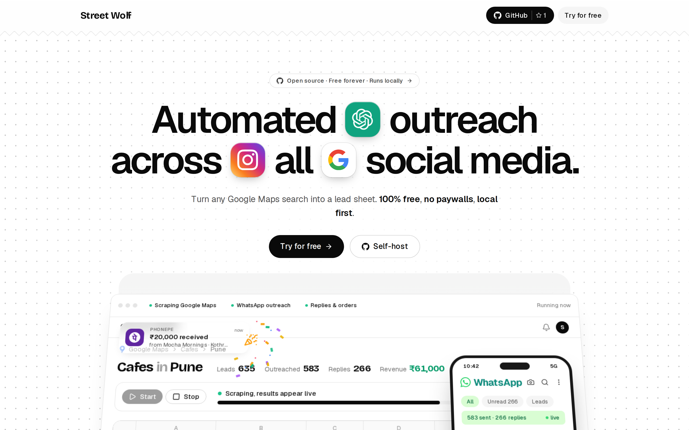
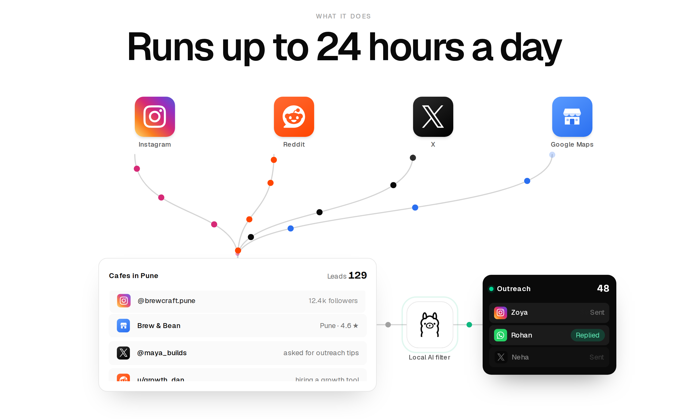
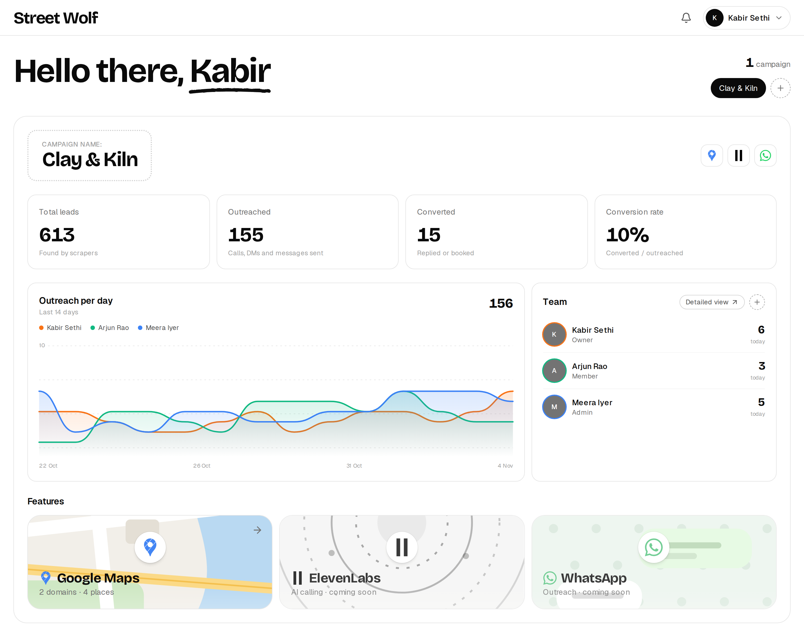
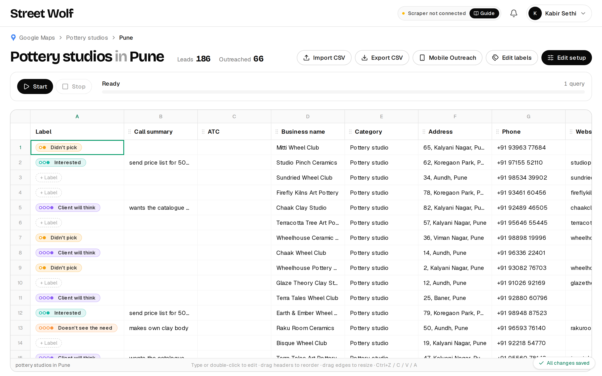
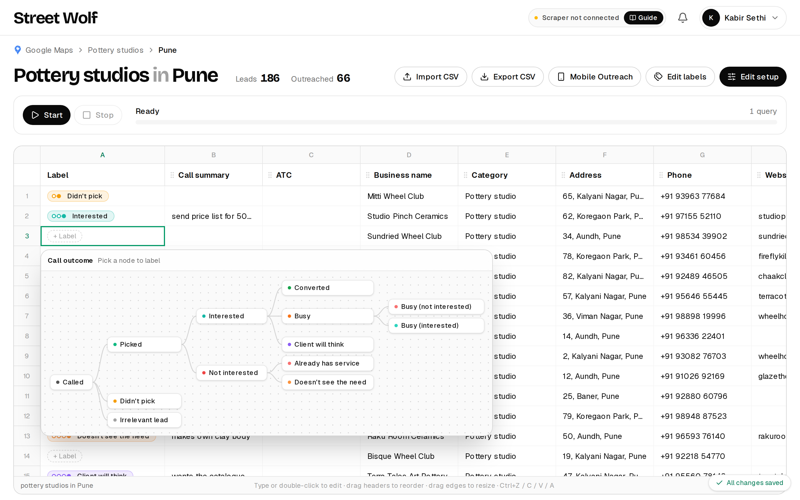

# Street Wolf

**Free, open-source, local-first lead generation.** Turn any Google Maps search into a live lead sheet (name, phone, website,
rating, reviews), shortlist the best fits, and run outreach with your team: call, WhatsApp, label every lead and keep call
notes. 100% free, no paywalls, and the scraper runs on your own computer. Instagram, Reddit and X scrapers are next.



## Screenshots

**How it works.** Leads from Instagram, Reddit, X and Google Maps flow into one sheet, a local AI filter (Ollama) keeps the
ones that look like real buyers, and the rest go straight to outreach.



**Dashboard.** Per campaign: lead, outreach and conversion totals, outreach per teammate per day, and the team.



**Lead sheet.** One sheet per niche and city, filled live by the scraper. Every row gets an outcome label and a call summary.



**Label graph.** Click a row's label cell to pick the call outcome from the tree.



<sub>The campaign, people and businesses in these screenshots are made-up demo data.</sub>

## What is in it

| Part | What it does |
| --- | --- |
| **Lead sheets** (`/dashboard`) | A spreadsheet per niche and city. Type, paste, drag columns, import and export CSV. Every row has an outcome **label** (a configurable tree such as Called › Picked › Interested › Converted) and a **Call summary** column. |
| **Google Maps scraper** (`apps/scraper`, `tools/google-maps`) | A fast, polite scraper installed on Windows or Linux. It claims jobs from the web app and streams results into the open sheet. Needs no account of its own, only a token from Settings. |
| **Dashboard** (`/dashboard`) | Per campaign: leads, outreached, converted and conversion rate, outreach per day per teammate, and the team. |
| **Teams** | Campaigns with owner, admin and member roles, email invites, in-app notifications, per-person daily outreach counts and charts. Many people can label one sheet at once; edits merge per cell. |
| **Mobile Outreach** (`/m/...`) | A phone layout of any sheet. Open the link from the sheet's **Mobile Outreach** button on a phone and sign in. See below. |
| **Landing site** (`/`) | Marketing page and SEO pages (`/google-maps-scraper`, `/run-locally`, `/open-source-lead-generation`). |

### Mobile Outreach

Same data, different screen, so labels set on the phone appear on the web (and for teammates) within seconds, and the other way round.

* Sign-in required: only people on the campaign can open a sheet's link.
* A top bar with search, a **To do** filter (unlabelled leads) and a column picker. By default only name and phone show; the choice is remembered on that phone.
* Each lead has icon-only buttons: **call** and **WhatsApp**. Both come from the same phone cell and understand Indian formats
  (`+91 98765 43210`, `098765 43210`, `98765-43210`, `0091…`, `020 2612 3456`, several numbers in one cell). Landlines and toll-free
  numbers get a call button only. See `apps/web/lib/phone.ts`.
* **Pamphlets:** ready follow-up messages that open WhatsApp with the text filled in, and a shareable image whose business name,
  prices and colour you can change. Stored in the browser for now (`apps/web/lib/pamphlets.ts`).
* **Call summary:** write points as `- first point - second point`; it shows as a list in a small dotted window, on web and phone.

### Call-outcome labels

Each campaign has a label tree (edit it with **Edit labels** on any sheet). The default:

```
Called
├─ Picked
│  ├─ Interested → Converted · Busy (interested / not interested) · Client will think
│  └─ Not interested → Already has service · Doesn't see the need
├─ Didn't pick
└─ Irrelevant lead
```

Every label except **Didn't pick** counts as outreach. See `apps/web/lib/labels.ts`.

## Stack

Next.js 16 · Node · MongoDB · TypeScript · pnpm + Turborepo. Custom auth (email link and Google), a durable email outbox,
motion and GSAP on the landing page.

```
apps/web        Next.js app: UI and API routes
apps/scraper    local scraper worker (Windows / Linux installers)
packages/db     MongoDB collections, types and indexes
packages/tool-sdk, tools/google-maps   the scraper tool contract and the Google Maps tool
scripts         e2e, load and unit-style tests, dev database
docs            architecture, database, deployment
```

## Run it

```bash
pnpm install
pnpm db:dev      # terminal 1: a throwaway local MongoDB (no Docker needed)
pnpm dev         # terminal 2: http://localhost:3000
```

Everything else (email, Google sign-in, cron) is optional until you want it; see the env table in
[docs/ARCHITECTURE.md](docs/ARCHITECTURE.md). To scrape, install the scraper from [apps/scraper](apps/scraper/README.md) and paste a
token from Settings → Integrations.

## Tests

```bash
node scripts/e2e.mjs      # API checks (needs a running server + MONGODB_URI)
node scripts/load.mjs     # 500-user simulation
pnpm test:merge           # how teammates' edits merge
pnpm test:phone           # Indian phone number parsing
```

## Docs

* [docs/ARCHITECTURE.md](docs/ARCHITECTURE.md): product context, backend overview, auth, teams, scaling.
* [docs/DATABASE.md](docs/DATABASE.md): every collection, index, counting rule and endpoint.
* [docs/DEPLOYMENT.md](docs/DEPLOYMENT.md): shipping it.
